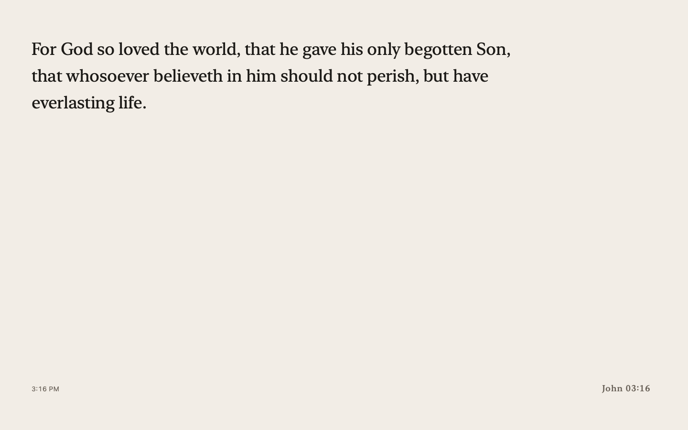
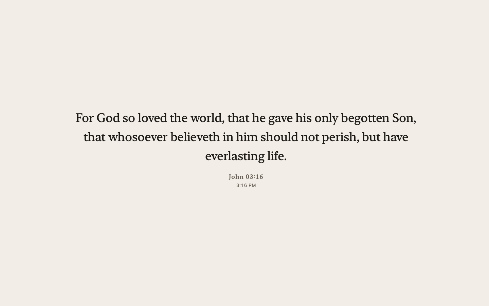
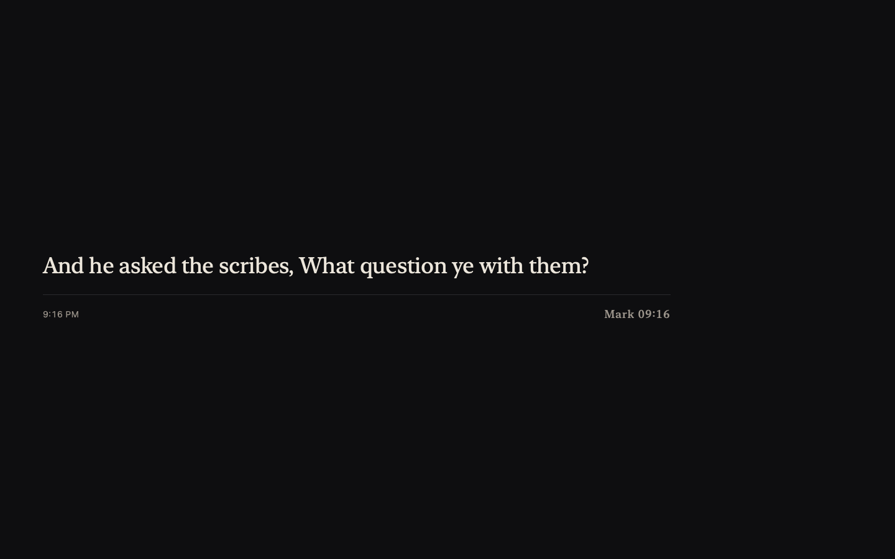

# BibleTime

A screen saver for **Windows** and **Mac** that tells the time through scripture. The chapter is the hour and the
verse is the minute: at 3:16 you'll see John 3:16, at 4:13 Philippians 4:13, and a new verse appears every minute.



It's free, works offline, and includes three public-domain Bible translations (King James Version, World English
Bible and American Standard Version).

## Download

| Your computer | Download | Then |
| --- | --- | --- |
| **Windows 10 or 11** | [**Download for Windows**](https://github.com/calebtonn/BibleTime/releases/latest/download/BibleTime-Windows-Setup.exe) | [Install on Windows](#install-on-windows) |
| **Mac** (macOS 12 Monterey or later) | [**Download for Mac**](https://github.com/calebtonn/BibleTime/releases/latest/download/BibleTime-macOS.zip) | [Install on a Mac](#install-on-a-mac) |

No administrator rights on your Windows PC (a work or school computer, for example)? Use the
[portable Windows version](https://github.com/calebtonn/BibleTime/releases/latest/download/BibleTime-Windows-Portable.zip)
instead; see [Windows without administrator rights](#windows-without-administrator-rights).

All versions and release notes are on the [Releases page](https://github.com/calebtonn/BibleTime/releases).

## Install on Windows

1. Click [**Download for Windows**](https://github.com/calebtonn/BibleTime/releases/latest/download/BibleTime-Windows-Setup.exe).
   If your browser says the file *isn't commonly downloaded*, keep it: in Edge, point at the download, click
   **…** › **Keep**, then **Show more** › **Keep anyway**. Then open `BibleTime-Windows-Setup.exe`.
2. Windows may show a blue box saying **"Windows protected your PC"**. Click **More info**, then **Run anyway**.
   These warnings appear because BibleTime is a free project that isn't signed with a paid certificate, not
   because anything is wrong with it.

   If instead you see **"Smart App Control blocked an app that may be unsafe"**, there is no way to allow it:
   Smart App Control (on some new Windows 11 PCs) only runs signed apps, so BibleTime can't be installed on
   that PC for now.
3. Click **Yes** when Windows asks whether to allow the app to make changes, then click **Install**.
4. On the last page, leave both boxes ticked and click **Finish**. BibleTime becomes your screen saver and the
   **Screen Saver Settings** window opens so you can see it.

That's it. To change how it looks (translation, layout, colours, typeface, text size):

- Open **Settings › Personalization › Lock screen › Screen saver**, make sure **BibleTime** is selected, and
  click **Settings…**. Click **Preview** to try it right away.
- In the same window you can choose how many minutes to wait before it starts.

**To uninstall:** open **Settings › Apps › Installed apps** (on Windows 10: **Settings › Apps**), find
**BibleTime Screen Saver**, and choose **Uninstall**.

### Windows without administrator rights

1. Download [BibleTime-Windows-Portable.zip](https://github.com/calebtonn/BibleTime/releases/latest/download/BibleTime-Windows-Portable.zip).
2. Right-click the zip file, choose **Extract All…**, then **Extract**.
3. Move `BibleTime.scr` to a folder where it can stay (your Documents folder, for example).
4. Right-click `BibleTime.scr` and choose **Install** (on Windows 11 you may need **Show more options** first).
   If you see "Windows protected your PC", click **More info**, then **Run anyway** (see step 2 above if Smart
   App Control blocks it).
5. The Screen Saver Settings window opens with BibleTime selected. Click **Settings…** to adjust it, then **OK**.

To remove it, choose another screen saver (or "(None)") in Screen Saver Settings and delete `BibleTime.scr`.

## Install on a Mac

1. Click [**Download for Mac**](https://github.com/calebtonn/BibleTime/releases/latest/download/BibleTime-macOS.zip).
   Safari unzips it for you; otherwise double-click `BibleTime-macOS.zip` to get `BibleTime.saver`.
2. BibleTime isn't notarized by Apple (that needs a paid Apple developer account), so the first time macOS will
   refuse to open it. Either:
   - double-click `BibleTime.saver` and close the warning (**Done** or **OK**). Then open **System Settings ›
     Privacy & Security** (on macOS 12 and 13: **System Preferences › Security & Privacy › General**), scroll
     down and click **Open Anyway**. On macOS 12–14 you can instead Control-click `BibleTime.saver`, choose
     **Open**, and confirm; or
   - remove the quarantine flag in Terminal, then double-click the bundle:
     ```bash
     xattr -dr com.apple.quarantine ~/Downloads/BibleTime.saver
     ```
3. Choose **Install for this user only**.
4. Pick BibleTime in **System Settings › Wallpaper › Screen Saver** (on macOS 12: **System Preferences ›
   Desktop & Screen Saver**) and click **Options…** to adjust it.

**To uninstall:** right-click BibleTime in the screen saver list and choose **Delete "BibleTime"**, or delete
`BibleTime.saver` from the `Library/Screen Savers` folder in your home folder (in Finder, hold **Option** and
open the **Go** menu to see **Library**).

## Requirements

- **Windows:** Windows 10 or Windows 11, 64-bit. Windows 11 on ARM PCs (Snapdragon, Surface Pro X) run it
  through Windows' built-in x64 emulation; Windows 10 on ARM is not supported. Nothing else to install.
- **Mac:** macOS 12 Monterey or later, Apple silicon or Intel.

## Features

- **Three public-domain translations**, bundled and offline: King James Version, World English Bible, and
  American Standard Version. You can [add others](#other-translations-esv-csb-lsb-niv-) you own.
- **Well-known verses first.** When a famous verse matches the minute (John 3:16, Philippians 4:13,
  Hebrews 11:1, Proverbs 3:5, Romans 8:28, Matthew 6:33 ...) it takes priority. Otherwise a verse is drawn
  from every book that has that chapter and verse, rotating daily (at midnight UTC) so every computer, Mac or PC,
  shows the same verse at the same minute.
- **Whole thoughts.** A verse that ends mid-sentence is extended with the next verse
  ("Romans 08:38–39") so what you read makes sense on its own. Genealogies, name lists and census tables
  are never shown.
- **Top of the hour** shows a verse about time and seasons (Psalm 90:12, Ecclesiastes 3:1, Psalm 118:24 ...),
  since there is no verse 0.
- **12- or 24-hour.** Follows your system clock setting; in 24-hour mode 15:16 prefers a chapter 15 verse.
- **Three layouts** (Clock, Centered, Book), **two themes** (Paper, Night, or automatic by appearance and time
  of day), five typefaces, an adjustable text size, an optional small clock.
- **Multiple displays.** Show verses on every display (the same one, or a different one per screen) or on the
  main display only, with the others kept dark.
- **Easy on the screen.** One crossfade per minute, a few points of drift every five minutes, and nothing else
  moving. Text scales to any display, high-DPI or not, portrait or ultrawide.
- **Native and light on both platforms.** On the Mac it is a Swift screen saver; on Windows a single small
  `BibleTime.scr` drawn with Direct2D and DirectWrite, with the verses built in and no runtimes to install. Both
  use the same verse-choosing logic, checked to give identical results.

| Centered, Paper | Book, Night |
| --- | --- |
|  |  |

## Options

On Windows: Screen Saver Settings › **Settings…**. On a Mac: Screen Saver › **Options…**.

| Setting | Values | Default |
| --- | --- | --- |
| Translation | KJV, WEB, ASV, or any you import | KJV |
| Hours | Follow System, 12-hour, 24-hour | Follow System |
| Appearance | Automatic, Paper, Night | Automatic (Night in dark mode or 8 pm–7 am) |
| Layout | Clock, Centered, Book | Clock |
| Typeface (Mac) | New York, Charter, Palatino, Georgia, San Francisco | New York |
| Typeface (Windows) | Sitka, Cambria, Palatino Linotype, Georgia, Segoe UI | Sitka |
| Text size | 75%–200% | 100% (4% of the screen height) |
| Displays | Main display only; All displays, same verse; All displays, different verses | All displays, same verse |
| Show the time | on/off | on |
| Prefer well-known verses | on/off | on |
| Complete the sentence | on/off | on |
| Pad the reference like a clock | on/off | on ("John 03:16") |

The Windows typefaces are the closest matches that ship with Windows, listed in the same order as the Mac ones
(Sitka for New York, Cambria for Charter, and so on). Windows keeps the settings in
`%APPDATA%\BibleTime\settings.json`.

## Other translations (ESV, CSB, LSB, NIV …)

Modern translations are copyrighted, so BibleTime cannot ship them. If you hold a copy you are licensed to
use (for example a USFX export of a module you bought), you can convert it and import it for your own use.
Converting needs Python 3 and a copy of this repository:

```bash
python3 -I Tools/build_verses.py build --source my-esv.usfx.xml --id esv \
    --name "English Standard Version" --abbreviation ESV \
    --publisher Crossway --license "Copyright 2001 Crossway. Personal use only." --out ~/Desktop/esv.json
```

Then open the options (**Settings…** on Windows, **Options…** on a Mac), click **Import…** next to the
translation menu, and choose the file. The import is checked (whole Bible, USFM book codes, a unique id) and
copied into the screen saver's own folder; nothing is sent anywhere. **Remove** deletes it again. You can also
drop a converted file into the folder by hand:

- **Windows:** `%APPDATA%\BibleTime\Translations\` (paste that into the File Explorer address bar)
- **Mac:** `~/Library/Application Support/BibleTime/Translations/`

If you have a [Biblia API](https://bibliaapi.com) key (Logos users often do; the Logos connector uses one), a second
converter pulls a translation straight from that API, which carries the Legacy Standard Bible among others:

```bash
export BIBLIA_API_KEY=your-key
python3 -I Tools/build_from_biblia.py --bible lgcystndrdbblsb --id lsb --name "Legacy Standard Bible" \
    --abbreviation LSB --publisher "The Lockman Foundation" \
    --license "Copyright 2021 The Lockman Foundation. Personal use only." --out ~/Desktop/lsb.json
```

It fetches the 837 chapters the clock can reach at two per second, caches the responses so it can resume, and writes the same
file format. Try `--only "John 3,Psalm 23"` first to check your key.

The conversion runs on your machine and the result stays there. Please do not commit converted copyrighted
text to this repository or share it; respect the publisher's terms.

## How a verse is chosen

For a time `H:MM`:

1. If `MM` is `00`, show a verse about time from `Resources/hour_verses.json`, walking through the list hour
   by hour.
2. Otherwise collect every verse numbered `H:MM` in the chosen translation (chapter 1–12, or 13–23 first in
   24-hour mode). The KJV has 12,858 such verses that read well on their own for the 12-hour dial, and 20,674 for 24 hours.
3. If "Prefer well-known verses" is on and `Resources/curated.json` lists verses for this minute, show one of
   them, rotating by day.
4. Otherwise pick at random, seeded by the date and minute, among verses that read well standalone.
   Verses flagged at build time as weak (a trailing comma, a dialogue tag) are used only when nothing better
   exists; verses flagged as lists (genealogies, rosters, census counts) are never used.
5. If the verse ends with a comma or dash and "Complete the sentence" is on, append the next verse or two.
6. Thirty-two minutes on the 12-hour dial have no usable verse in the KJV (2:53–2:59, 4:55–4:59,
   5:49–5:59, 10:53–10:59, 11:58 and 11:59: the only chapters that long there are censuses and
   genealogies). Those show a verse about time as well.

All of this lives in `Sources/BibleTimeCore` (Swift, covered by `make test`) and its C++ port in
`Windows/src/core` (covered by `core_tests`). `make crosscheck` and CI check that both pick exactly the same
verses.

## Scripture text

The translations come from [eBible.org](https://ebible.org) and are public domain; the exact editions,
download dates and checksums are recorded in [DATA-LICENSE.md](DATA-LICENSE.md). `Tools/build_verses.py`
turns the USFX source files into the compact JSON in `Resources/Translations/`, dropping Psalm titles,
footnotes and Strong's numbers, and flags verses that read poorly on their own.

## Build from source

If you trust the source more than the downloads, build it yourself; it takes a minute. See
[CONTRIBUTING.md](CONTRIBUTING.md) for the full development loop.

### Mac

Needs the Xcode Command Line Tools (`xcode-select --install`); full Xcode is not required.

```bash
git clone https://github.com/calebtonn/BibleTime.git
cd BibleTime
make install
```

`make` produces `build/BibleTime.saver` (universal, arm64 + x86_64). `make test` runs the unit tests, and
`make render` writes screenshots of every layout to `build/renders/` without touching System Settings. If you
prefer Xcode, `make xcodeproj` generates a project with [XcodeGen](https://github.com/yonaskolb/XcodeGen).

### Windows

Needs Visual Studio 2022 (the "Desktop development with C++" workload, which includes CMake):

```bat
git clone https://github.com/calebtonn/BibleTime.git
cd BibleTime
cmake -S Windows -B build\windows -A x64
cmake --build build\windows --config Release
build\windows\bin\core_tests.exe Resources
```

The screen saver is `build\windows\bin\BibleTime.scr`: right-click it and choose **Install**, or run
`BibleTime.scr /s` to start it full screen. To build the installer as well, install
[Inno Setup 6](https://jrsoftware.org/isinfo.php) and run
`"C:\Program Files (x86)\Inno Setup 6\ISCC.exe" Windows\installer\BibleTime.iss`
(it writes `build\windows\installer\BibleTime-Windows-Setup.exe`).

You can also cross-compile from Linux or macOS with mingw-w64:

```bash
cmake -S Windows -B build/windows-mingw -DCMAKE_TOOLCHAIN_FILE="$PWD/Windows/cmake/mingw-w64.cmake" -DCMAKE_BUILD_TYPE=Release
cmake --build build/windows-mingw
```

### Releases

Pushing a tag `v<VERSION>` (for example `v1.1.0`, matching the `VERSION` file) makes GitHub Actions build and
test both platforms and publish one release with `BibleTime-Windows-Setup.exe`, `BibleTime-Windows-Portable.zip`
and `BibleTime-macOS.zip`. The download links at the top of this page always point at the newest release.

## Credits and prior art

It is inspired by the [Bible Clock](https://bibleclock.com) hardware clock, which does the same thing on a
7-inch display in a wooden frame. BibleTime is an independent open-source project and is not affiliated with
Bible Clock.

- [Bible Clock](https://bibleclock.com) for the idea of telling time through scripture.
- Other verse clocks whose choices informed this one: [VerseTime](https://github.com/TroyWolf/VerseTime),
  [verse-clock](https://github.com/NJShell2/verse-clock),
  [Bible-clock-widget](https://github.com/Halo225/Bible-clock-widget),
  [MMM-BibleVerseClock](https://github.com/Tydyrium/MMM-BibleVerseClock) and
  [markyharris/bible_clock](https://github.com/markyharris/bible_clock).
- [ScreenSaverMinimal](https://github.com/mirkofetter/ScreenSaverMinimal) and
  [Aerial](https://github.com/JohnCoates/Aerial) for documenting the quirks of `legacyScreenSaver`.

## License

The code, build scripts and artwork are MIT licensed; see [LICENSE](LICENSE). That license does not cover
the Scripture text in `Resources/Translations/`, which is public domain; its provenance is recorded in
[DATA-LICENSE.md](DATA-LICENSE.md). "World English Bible" is a trademark of eBible.org; the text is shipped
unmodified apart from the formatting described there.
